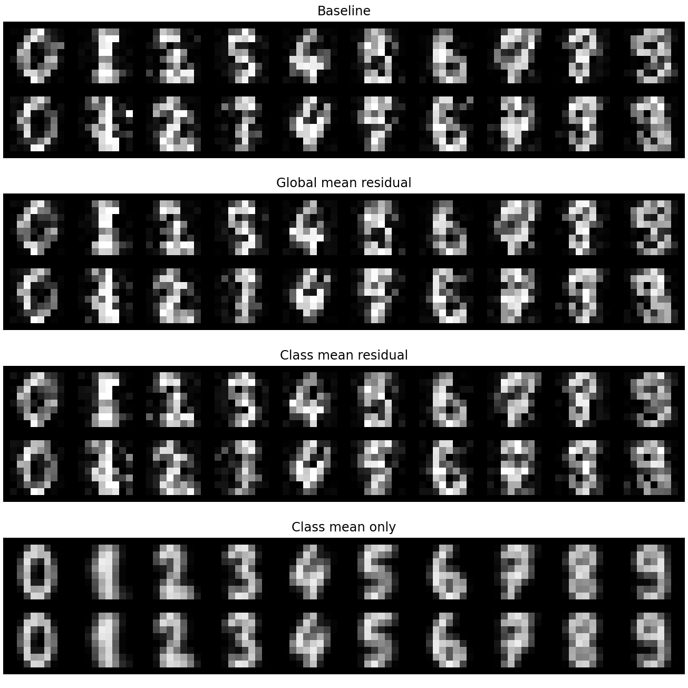

# 手写数字生成中的类别均值残差扩散

在 8×8 手写数字上复现像素空间掩码自回归生成（MAR）与逐图块扩散损失，并检验一个改动：把每个图块的扩散目标改为相对训练集类别平均图的残差。给定类别 0–9，模型从空画布生成图像。支持向量机只用于评测。

## 论文与代码来源

Tianhong Li, Yonglong Tian, He Li, Mingyang Deng, Kaiming He. *Autoregressive Image Generation without Vector Quantization*. NeurIPS 2024 主会，卷 37，DOI 10.52202/079017-1797。参见[正式论文](https://proceedings.neurips.cc/paper_files/paper/2024/hash/66e226469f20625aaebddbe47f0ca997-Abstract-Conference.html)、[论文 PDF（附录 D.1 为像素图块实验）](https://papers.neurips.cc/paper_files/paper/2024/file/66e226469f20625aaebddbe47f0ca997-Paper-Conference.pdf)、[CCF 人工智能目录](https://www.ccf.org.cn/Academic_Evaluation/AI/)。

作者公开实现参考版本为 [LTH14/mar @ c6d53f7](https://github.com/LTH14/mar/tree/c6d53f7fa6427634b5850ebed771b7c2d19ea21f)。本仓库依据论文独立编写 NumPy 代码，使用 AI 辅助实现与实验整理。全部可训练参数从随机初始化开始。保留随机掩码上下文、已见图块条件、连续图块噪声预测损失、随机顺序分组解码。原文 D.1 在 64×64 ImageNet 上使用 4×4 RGB 图块及 MAR-L。此处为 8×8 灰度图、2×2 图块和轻量 MLP 上下文网络，无预训练分词器、无分类器自由引导。实验问题是小模型如何利用类别信息，不能和论文 ImageNet FID 横向比较。

## 实验设计

- baseline 预测原图块的噪声；global 预测减去全局均值后的噪声；class 预测减去对应类别均值后的噪声。生成时加回同一均值。均值只取自训练集，所有组均提供类别标签。另有直接输出类别均值的诊断。
- 使用 scikit-learn 随包提供的 [Digits 数据](https://scikit-learn.org/stable/modules/generated/sklearn.datasets.load_digits.html)。1797 张图，分层划分种子 23，训练 1437 张、测试 360 张。像素从 [0,16] 映射至 [−1,1]。测试集只参与评测。
- 单图 16 块。训练时均匀抽取可见块数 0、4、8 或 12，随后从隐藏块中均匀抽取一个目标。上下文包含已见像素、可见标记、类别和目标位置。去噪头还接收当前含噪块和时间步。采用均方噪声预测损失，训练代码显式计算梯度。采样共 4 轮，每轮并行生成 4 块，每块以同一余弦角度日程做 16 步确定性反推，初始噪声与图块顺序配对。
- 网络为 106→64 的 tanh 上下文层及 84→80→4 去噪头，固定高斯跳连，可训练参数 13972 个。三组网络、初始化、数据抽样和训练步数一一配对。Adam 学习率 0.001、β=(0.9,0.999)、ε=1e−8、批量 128。
- 训练种子 11、22、33。分别在 2500 步与 30000 步实验中从头训练，两个预算对同一组使用一致的起点。采样种子固定 1201，每个模型 1000 张，每类 100 张。平台为 Windows、AMD Ryzen 9 6900HX、数值计算单线程、Python 3.13.9。短训练单次约 1.5 秒；长训练单次 19.9–22.2 秒，均为训练循环计时。环境初始化、评测和写检查点另计。

## 安装与复跑

使用 Python 3.13 建立独立环境，然后安装依赖。安装完成后，数据从本机包中读取。以下为 PowerShell，在仓库根目录执行。复跑输出到 local，以保留随仓库提供的原始实验记录。

~~~powershell
python -m venv .venv
.\.venv\Scripts\python.exe -m pip install -r requirements.txt
$py = '.\.venv\Scripts\python.exe'
foreach ($seed in 11,22,33) {
    foreach ($mode in 'baseline','global','class') {
        & $py experiment.py --mode $mode --seed $seed --steps 30000 --out local/repeat
    }
}
& $py evaluate.py --runs local/repeat --out local/metrics
~~~

单次训练可运行 `python experiment.py --mode class --seed 11 --steps 30000 --out local/repeat`。复跑短预算时将步数改为 2500，并另选输出目录。生成与评测同一入口会读取同一训练种子下的三组检查点。使用现有权重可立即重建图表：

~~~powershell
python evaluate.py --runs runs-long --out local/check-long
python evaluate.py --runs runs --out local/check-short
~~~

## 实测结果

三项指标依次为评测分类器对指定标签的命中率、类条件核分布差异 MMD²、类内像素方差。MMD² 对每类生成与测试图像计算带对角项的 RBF 核均值差平方，γ=1/32，再等权平均十类，越小表示在此度量下越接近。类内方差对每类各像素计算总体方差，再对像素和类别平均，真实参照为 0.17025。训练集拟合的 RBF-SVM（C=10，γ=scale）在真实测试集上的识别率为 358/360，即 99.44%。

| 方法 | 2500 步命中率 | 30000 步命中率 | 30000 步 MMD² ↓ | 30000 步类内方差 |
|---|---:|---:|---:|---:|
| 基线 | 12.90% | 90.67% | 0.05068 | 0.15900 |
| 全局均值残差 | 13.33% | 90.80% | 0.05157 | 0.15134 |
| 类别均值残差 | 92.00% | 95.83% | 0.05114 | 0.12744 |
| 直接输出类别均值 | 100% | 100% | 0.11257 | ≈0 |

在三个长训练种子中，改进版的标签命中率都高于基线，跨种子平均提高 5.17 个百分点。类别内变化随之收窄，MMD² 和基线接近，均值略高。只输出均值可以达到满分命中率，却丧失同类字形变化。实验只支持这份划分、小模型与固定采样协议下的结论。三个训练种子不足以推断对其他任务的普遍优势。

长训练使用种子 11 的各组前 20 张；每组两行，列为数字 0–9。直接输出均值一项不使用随机噪声。

## 代码与证据

- `experiment.py` 包括数据划分、图块表示、计算先验、前向与反向传播、Adam 和按块采样。`evaluate.py` 包括生成、三项指标、基于检查点重建图表。
- `runs/` 和 `runs-long/` 分别保存两种预算下共 18 次训练的配置、每百步均值日志、权重和训练先验。每条记录保留实际耗时。
- `results/` 和 `results-long/` 保存逐种子指标、真实数据参照、训练损失图和配对图。`paired_samples.npz` 保存种子 11 的全部配对生成图与标签，归一化范围 [−1,1]。
